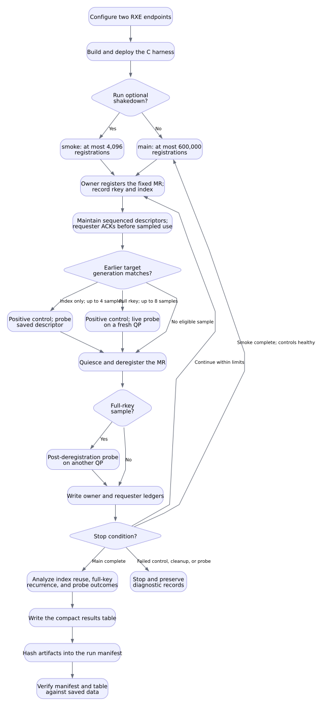

# RXE rkey churn experiment

Code for a two-endpoint RXE experiment that records MR pool-index reuse, complete rkey recurrence, and sampled RDMA WRITE outcomes after registration and deregistration.

## Check the code

```sh
bash scripts/test_source.sh
```

This runs the source-only tests without an RDMA device or experiment data. Python 3.11 or newer is required. The full test suite needs the experiment dataset; see [Reproducing the experiment](REPRODUCING.md).

## Configure a lab

```sh
cp config.example.toml config.local.toml
```

Set the two VM addresses, SSH user and key path, and remote directory in `config.local.toml`. The file is ignored by Git. The deployment, run, diagnostics, and manifest scripts read the same configuration with `--config config.local.toml`.

## Run roles

The primary result is a single `main` run (at most 600,000 successful owner target-MR registrations). An optional short diagnostic auxiliary — internal role `smoke` (at most 4,096 registrations), called the *shakedown* in user-facing docs — may precede it. Across all attempts the hard ceiling is 604,096 successful target registrations and 900 s from the first registration through final cleanup. The earlier pilot-based revision stays frozen at the `original-run` git tag.

## Experiment flow

The optional shakedown and the main run use the same registration cycle. Each run has separate owner and requester ledgers and its own limits; only the main run supplies the primary recurrence counts.



[Diagram source (DOT)](docs/experiment-flow.dot)

## Files

- `src/churn.c`: RDMA experiment program.
- `scripts/deploy.py` and `scripts/run.py`: build, deployment, and run launchers.
- `scripts/check_summary.py`: checks that `docs/reproduction-results.md` agrees with `results/analysis.json`.
- `ledger.py`, `analyzer.py`, and `verify.py`: data recording, analysis, and integrity checks.
- `tests/`: unit and dataset checks.
- `docs/ledger-schema.md`: ledger format.
- `docs/reproduction-results.md`: compact results table of the reproduction-validation run.

Raw results are not included in this repository.
